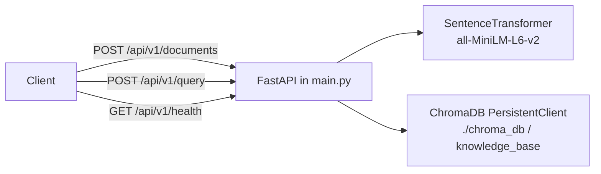

# Lightweight RAG API

A small FastAPI service that embeds documents with a local Sentence Transformer model and retrieves the closest matches from a persistent ChromaDB collection.

## Overview

This repository is a retrieval service, not a full RAG chain: it stores text, turns queries into embeddings, and returns similar documents. There is no language-model step that would generate an answer from those matches.

The working application lives in the root `main.py`. On import it loads the `all-MiniLM-L6-v2` embedding model, opens a ChromaDB persistent client at `./chroma_db`, and gets or creates a collection named `knowledge_base`.

You can:

- add documents and caller-supplied IDs
- query the collection for the nearest neighbors of a free-text prompt
- check that the process is up

The first start can take a while, because `SentenceTransformer("all-MiniLM-L6-v2")` downloads the model if it is not already cached.

## Tech stack

Pinned in `requirements.txt`:

- FastAPI `0.110.0` and Uvicorn `0.28.0`
- Pydantic `2.6.4`
- `sentence-transformers` `2.5.1` (`all-MiniLM-L6-v2`)
- ChromaDB `0.4.24`
- NumPy `1.26.4`
- `posthog` `3.5.0` (declared alongside ChromaDB)

No environment variables are required. Vector data is written to `./chroma_db`, which is listed in `.gitignore`. There is no test suite.

## Architecture



## How to run locally

From the repository root:

```bash
python3 -m venv .venv
source .venv/bin/activate   # Windows: .venv\Scripts\activate
pip install -r requirements.txt
uvicorn main:app --reload
```

Run Uvicorn from the repo root so the Chroma path `./chroma_db` is created where you expect. FastAPI also serves the interactive docs at [http://localhost:8000/docs](http://localhost:8000/docs).

## Endpoints

The app title is **Lightweight RAG API**, version `1.0.0`.

### `POST /api/v1/documents`

Ingests texts into the local collection. Responds with `201` and `{"status": "success", "added_count": <n>}` when the add succeeds.

Request body:

```json
{
  "documents": ["Paris is the capital of France.", "The Nile is a river in Africa."],
  "ids": ["doc-1", "doc-2"]
}
```

`documents` and `ids` must be lists of the same length. The handler encodes `documents` with the Sentence Transformer and calls `collection.add(...)`.

Example:

```bash
curl -s -X POST http://localhost:8000/api/v1/documents \
  -H "Content-Type: application/json" \
  -d '{"documents":["Paris is the capital of France.","The Nile is a river in Africa."],"ids":["doc-1","doc-2"]}'
```

### `POST /api/v1/query`

Embeds `query` and asks Chroma for `n_results` nearest documents (default `2`). The JSON response is:

```json
{
  "query": "What is the capital of France?",
  "matches": [["Paris is the capital of France."]]
}
```

`matches` is the `documents` field from Chroma's `collection.query` result (a list of hit lists, one per query).

```bash
curl -s -X POST http://localhost:8000/api/v1/query \
  -H "Content-Type: application/json" \
  -d '{"query":"What is the capital of France?","n_results":2}'
```

### `GET /api/v1/health`

```bash
curl -s http://localhost:8000/api/v1/health
```

```json
{"status": "online", "service": "RAG API running successfully"}
```

## Project structure

```
.
├── main.py                 # The running FastAPI app (schemas, embeddings, routes)
├── requirements.txt
├── Dockerfile              # Empty placeholder
├── app/                    # Package skeleton only; the modules are empty
│   ├── __init__.py
│   ├── main.py
│   ├── schemas.py
│   ├── routers/
│   │   ├── __init__.py
│   │   └── rag_router.py
│   └── services/
│       ├── __init__.py
│       └── rag_service.py
└── README.md
```

## Roadmap

The layout already sketches a packaged FastAPI app (`app/main.py`, `app/routers/rag_router.py`, `app/schemas.py`, `app/services/rag_service.py`), but those files are empty. All behavior is still in the root `main.py`.

The `Dockerfile` is also empty, so the service is not containerized yet. Natural next steps are to move the current routes and schemas into that package, add a real image (and maybe a compose file for a persisted `chroma_db` volume), and decide whether to add a generation step on top of the retrieved context.
